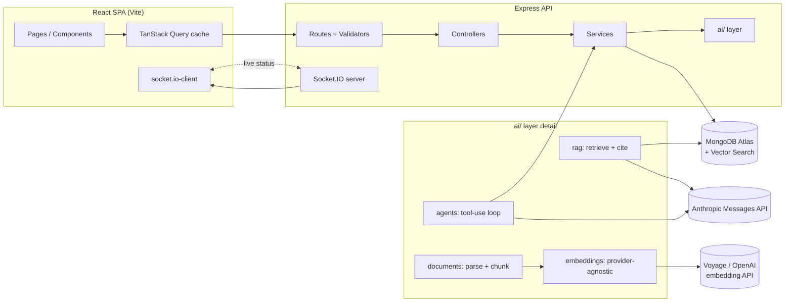
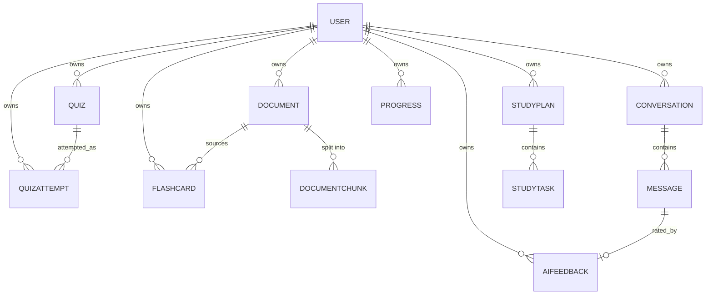

# AI Study Copilot — Engineering Plan

**Purpose of this document.** This is the specification to build against — written in full *before* writing any code, so that implementing each phase is a transcription exercise against a concrete plan, not an improvisation. Every phase states its data model, its API contract, its algorithms (as precise formulas or pseudocode, not vague prose), its file list, and its Definition of Done.

**How to use this document.** Build phases in order — each depends on the data model and services of the ones before it. Within a phase, build in the sub-order listed (data model → services → routes → tests → UI), and don't start a phase's UI until its API is implemented and tested. Each phase ends with an explicit Definition of Done; treat it as a gate, not a suggestion. Decide the conventions in §6 before writing Phase 1's first line of code — retrofitting a consistent error shape, validation strategy, or ownership pattern after several phases exist is expensive; deciding it up front costs nothing.

---

## Table of contents

1. [Product recap](#1-product-recap)
2. [Architecture overview](#2-architecture-overview)
3. [Technology decisions](#3-technology-decisions)
4. [Data model (all 12 collections)](#4-data-model-all-12-collections)
5. [API contract (all endpoints)](#5-api-contract-all-endpoints)
6. [Engineering standards to apply from Phase 1 onward](#6-engineering-standards-to-apply-from-phase-1-onward)
7. [Phase 1 — Foundation & Auth](#phase-1--foundation--auth)
8. [Phase 2 — Document Upload & Processing](#phase-2--document-upload--processing)
9. [Phase 3 — RAG & Claude Integration](#phase-3--rag--claude-integration)
10. [Phase 4 — AI Chat, Summaries, Explanations](#phase-4--ai-chat-summaries-explanations)
11. [Phase 5 — Quizzes & Adaptive Learning](#phase-5--quizzes--adaptive-learning)
12. [Phase 6 — Flashcards & Spaced Repetition](#phase-6--flashcards--spaced-repetition)
13. [Phase 7 — Study Planner & Agentic Assistant](#phase-7--study-planner--agentic-assistant)
14. [Phase 8 — Research Mode & Multimodal](#phase-8--research-mode--multimodal)
15. [Phase 9 — Analytics, Feedback & RAG Evaluation](#phase-9--analytics-feedback--rag-evaluation)
16. [Phase 10 — Hardening, Docker, Deployment](#phase-10--hardening-docker-deployment)
17. [Testing strategy matrix](#17-testing-strategy-matrix)
18. [Security checklist](#18-security-checklist)
19. [Spec traceability matrix](#19-spec-traceability-matrix)
20. [Verifying AI integrations without live API calls](#20-verifying-ai-integrations-without-live-api-calls)
21. [Environment variable reference](#21-environment-variable-reference)

---

## 1. Product recap

AI Study Copilot is a MERN application where a student uploads their own study material (PDF, DOCX, PPTX, TXT, images) and gets: grounded Q&A with citations, summaries and explanations, adaptive quizzes, spaced-repetition flashcards, a study plan that revises itself, and an agentic assistant that can inspect their progress and act on it (generate practice, schedule tasks). It is not a PDF chatbot: the bar is that every AI feature is grounded in retrieval, structured, adaptive to the individual student, and honest about the limits of what it's been given.

## 2. Architecture overview



**Layering rule (decide this in Phase 1, hold it for every later phase):** routes only validate and call a controller; controllers only translate HTTP ↔ service calls; services hold business logic and touch the database; the `ai/` tree holds every AI-specific concern (prompting, retrieval, parsing, tool execution) and is never imported directly by a controller — services call into `ai/`, not the other way round. This is what "keep AI logic out of route handlers" and "separate RAG from general prompting" cash out to concretely, and it's far easier to hold this line from the first file than to refactor into it later.

## 3. Technology decisions

Decide these up front; revisiting a foundational choice mid-project (e.g. swapping validation libraries after 40 routes exist) is expensive.

| Decision | Choice | Why |
| --- | --- | --- |
| Backend framework | Express 5 | Native async/await error propagation (no `express-async-handler` wrapper needed) |
| Validation | Zod, `strictObject` schemas | Rejects unknown fields (blocks mass-assignment/role-escalation) and NoSQL-operator-shaped input by construction |
| Auth | JWT + `tokenVersion` | Stateless like a pure JWT, but revocable (logout/password-change bump the version, invalidating old tokens) without a server-side session store |
| File storage | Local disk (`UPLOAD_DIR`) + `storageKey` on `Document` | Simple to start; Dockerize it as a volume later; swapping to S3 later only touches one file (`services/fileStorage.js`) if that file is the *only* thing that reads/writes storage paths |
| MIME validation | Magic-byte sniffing, not file extension | Never trust a client-supplied extension or `Content-Type` header |
| Chunking | Page/slide-aware, \~1000 chars, 150 overlap | A chunk never spans two PDF pages or two slides, so every chunk has one unambiguous citation |
| Embeddings | Configurable: Voyage (default/recommended) / OpenAI / local hashing fallback | Anthropic has no embeddings API of its own; a local fallback means the app runs with zero external API keys for development |
| Vector search | Atlas `$vectorSearch`, in-process cosine fallback | Works in production (Atlas) and in any local/CI environment without Atlas |
| LLM | Anthropic Messages API via the official SDK | The product's AI provider per spec |
| Citations | Numbered source list, Claude cites by number only | Structurally prevents fabricated sources — Claude can select from a list you built, not invent one |
| Realtime | Socket.IO, polling fallback | Used for document status first; reused for chat streaming and quiz-generation progress later |
| Client state | TanStack Query | Server state (documents, quizzes, etc.) is cache-and-sync, not hand-rolled Redux |
| Client styling | Tailwind + hand-built primitives | No component library lock-in; full control of a distinctive, non-templated look |
| Testing DB | `mongodb-memory-server` or any MongoDB URI | Atlas-only features (`$vectorSearch`) must degrade to a fallback path automatically under test, so the suite is never blocked on having an Atlas cluster |

## 4. Data model (all 12 collections)



Every collection is designed in full in the phase that creates it (not duplicated here) and enforces ownership (`owner: ObjectId`, indexed, every query scoped to `req.user.id`) from the moment it's created — this is non-negotiable and should be checked by an integration test the same day the model is written, not added later.

| Collection | Owner field | Designed in |
| --- | --- | --- |
| `User` | — (is the owner) | Phase 1 |
| `Document` | `owner` | Phase 2 |
| `DocumentChunk` | `owner` | Phase 2 (vectors populated Phase 3) |
| `Conversation` | `owner` | Phase 4 |
| `Message` | `owner` | Phase 4 |
| `Quiz` | `owner` | Phase 5 |
| `QuizAttempt` | `owner` | Phase 5 |
| `Flashcard` | `owner` | Phase 6 |
| `StudyPlan` | `owner` | Phase 7 |
| `StudyTask` | `owner` | Phase 7 |
| `Progress` | `owner` | Phase 5 (read by 7, 9) |
| `AIFeedback` | `owner` | Phase 9 |

## 5. API contract (all endpoints)

Fix the error shape and list-response shape in Phase 1 and never deviate: errors are `{ error: { code, message, details? } }`; every list endpoint returns `{ items, total, page, limit, totalPages }` (named per resource, e.g. `documents`/`conversations`/`quizzes`).

| Method & path | Phase | Auth | Body / Query | Success | Notes |
| --- | --- | --- | --- | --- | --- |
| `POST /api/auth/register` | 1 | — | `{name,email,password}` | 201 `{user,token}` |  |
| `POST /api/auth/login` | 1 | — | `{email,password}` | 200 `{user,token}` |  |
| `POST /api/auth/logout` | 1 | v | — | 204 | revokes token |
| `GET /api/auth/me` | 1 | v | — | 200 `{user}` |  |
| `PATCH /api/auth/me` | 1 | v | `{name?,preferences?}` | 200 `{user}` |  |
| `POST /api/auth/change-password` | 1 | v | `{currentPassword,newPassword}` | 200 `{user,token}` | revokes other sessions |
| `POST /api/documents/upload` | 2 | v | multipart `file`, `subject?` | 201 `{document}` | async processing |
| `GET /api/documents` | 2 | v | `status?,documentType?,search?,page?,limit?` | 200 list |  |
| `GET /api/documents/:id` | 2 | v | — | 200 `{document}` |  |
| `DELETE /api/documents/:id` | 2 | v | — | 204 |  |
| `POST /api/ai/chat` | 3 | v | `{question,documentIds?}` | 200 `{answer,citations,insufficientContext,retrievedChunkCount}` | stateless; superseded in shape by Phase 4's conversation-aware version below |
| `POST /api/ai/chat` *(upgraded)* | 4 | v | `{conversationId?,question,documentIds?,subject?,mode?}` | 200 `{conversationId,message}` | persists to `Conversation`/`Message`; streams over Socket.IO |
| `GET /api/ai/conversations` | 4 | v | `page?,limit?` | 200 list |  |
| `GET /api/ai/conversations/:id` | 4 | v | — | 200 `{conversation,messages}` |  |
| `DELETE /api/ai/conversations/:id` | 4 | v | — | 204 |  |
| `POST /api/ai/explain` | 4 | v | `{conversationId?,text?,documentIds?,style}` | 200 `{message}` | `style` in simple/analogy/example/step_by_step/compare/revision_note |
| `POST /api/ai/summarize` | 4 | v | `{documentId}` | 200 `{summary,citations}` | whole-document summary |
| `POST /api/ai/quiz` | 5 | v | `{subject,topic,documentIds?,count,difficulty?,questionTypes}` | 201 `{quiz}` | `difficulty` optional — defaults from `Progress` |
| `GET /api/quizzes` | 5 | v | `subject?,topic?,page?,limit?` | 200 list |  |
| `GET /api/quizzes/:id` | 5 | v | — | 200 `{quiz}` |  |
| `POST /api/quizzes/:id/submit` | 5 | v | `{answers:[{questionId,response}]}` | 201 `{attempt}` | scores, updates `Progress` |
| `GET /api/quizzes/history` | 5 | v | `subject?,page?,limit?` | 200 list of attempts |  |
| `GET /api/progress` | 5 | v | `subject?` | 200 `{topics:[...]}` |  |
| `GET /api/progress/weak-topics` | 5 | v | — | 200 `{topics:[...]}` | accuracy \<= 50% |
| `POST /api/ai/flashcards` | 6 | v | `{subject,topic,documentIds?,count}` | 201 `{flashcards:[...]}` |  |
| `GET /api/flashcards` | 6 | v | `subject?,dueOnly?,page?,limit?` | 200 list |  |
| `POST /api/flashcards/:id/review` | 6 | v | `{grade}` | 200 `{flashcard}` | `grade` in again/hard/good/easy; runs SM-2 |
| `DELETE /api/flashcards/:id` | 6 | v | — | 204 |  |
| `POST /api/study-plan` | 7 | v | `{examName,subject,examDate,hoursPerDay,topics}` | 201 `{studyPlan,tasks}` |  |
| `GET /api/study-plan` | 7 | v | — | 200 `{studyPlan,tasks}` | active plan |
| `PATCH /api/study-plan/:id` | 7 | v | `{examDate?,hoursPerDay?,topics?}` | 200 `{studyPlan}` | triggers task re-generation |
| `PATCH /api/study-tasks/:id` | 7 | v | `{status?,scheduledDate?,durationMinutes?}` | 200 `{task}` | complete/skip/reschedule/edit |
| `POST /api/ai/agent` | 7 | v | `{conversationId?,message}` | 200 `{message,toolCalls:[...]}` | the agentic endpoint; tool trace included for transparency |
| `PATCH /api/ai/chat/mode` | 8 | v | `{conversationId,mode}` | 200 `{conversation}` | toggles Study/Research |
| `GET /api/progress/analytics` | 9 | v | `range?` | 200 `{...}` | full analytics payload, §15 |
| `POST /api/feedback` | 9 | v | `{messageId,rating}` | 201 `{feedback}` |  |
| `GET /api/admin/eval` | 9 | v (admin) | `range?` | 200 `{...}` | internal eval dashboard data |

## 6. Engineering standards to apply from Phase 1 onward

Decide these before Phase 1's first commit. Every later phase assumes they hold, and every test added in each phase should check them the same way.

- **Ownership checks are structural, not incidental.** Every query that could leak cross-user data must scope by `owner: req.user.id` *in the service layer* (not only in the route, and not only relied on via input validation). The gold-standard pattern for this: when retrieval accepts an optional list of IDs from the client (e.g. "search only these documents"), the owner filter is combined with it via `$and` at the database layer, so a malicious ID belonging to another user simply matches nothing — ownership is enforced by what the query *can* return, not by a separate check that could be forgotten on one route.
- **Validation is `strictObject`, always.** Every Zod body/query schema rejects unknown keys. This is what stops a client from smuggling `role: "admin"` or a Mongo operator (`{ "$gt": "" }`) into a field expected to be a plain string.
- **Services return domain errors via a shared `ApiError` class, not raw throws.** `ApiError.notFound()`, `.badRequest()`, `.conflict()`, etc.; a single global error-handling middleware maps these to the fixed error shape from §5. AI-calling services additionally need their own mapping for provider failures (missing key → 503, rate limited → 429, provider down → 503) — build this once in the Claude client wrapper so every AI endpoint gets it for free rather than re-implementing it per route.
- **Pure logic is extracted into standalone functions and unit-tested without a database.** Chunking, similarity scoring, citation parsing, SM-2 scheduling, adaptive-difficulty decisions, and study-plan weighting are all pure functions of their inputs. This is deliberate: a reviewer (or you, three months later) should be able to verify these algorithms by reading a table of test cases, not by reading prose or re-deriving them from the code.
- **Integration tests run against any MongoDB**, with Atlas-only features (`$vectorSearch`) falling back automatically, so the test suite is never blocked on having an Atlas cluster available.
- **Every mutation that changes AI-visible state publishes a realtime event** through a single internal event emitter, so the Socket.IO layer can forward it without every service importing `socket.io` directly. Document-processing status is the first consumer of this pattern; message creation (Phase 4) and quiz generation (Phase 5) follow the same pattern rather than inventing a new one.
- **Client queries are owned by one `hooks/useX.js` file per resource**: a `useXQuery`, mutations with optimistic updates where it's safe to do so cheaply (deletes), and plain cache invalidation where it isn't (anything AI-generated, since you can't optimistically guess the result). For anything a dashboard-style summary reads (a count or a "recent items" list shown outside its own feature page), use `refetchOnMount: 'always'` rather than relying on cross-page cache invalidation to reach it — an inactive query is not guaranteed to refetch on remount just because it was invalidated while inactive, so a dashboard count can silently go stale after navigation if this is skipped. Verify this with a test that actually navigates away and back, not just one that calls the invalidation function.
- **Anything that changes how a request is sent or received gets a real-browser check**, not just a mocked test. Multipart uploads, streaming responses, and websocket events are exactly the kind of thing a mocked HTTP layer in a test suite will happily pass while the real browser silently fails (a classic example: a global default `Content-Type: application/json` header on an HTTP client can silently break multipart file uploads, because the client never gets the chance to set its own multipart boundary — every test that mocks the upload call will still pass). Budget time for a scripted real-browser pass at the end of any phase that introduces a new request pattern.

---

## Phase 1 — Foundation & Auth

**Goal.** Stand up the project skeleton (`client/` and `server/` as npm workspaces), decide the conventions in §6, and implement JWT authentication with server-side revocation plus the base authenticated app shell (protected routing, dashboard, profile).

### Data model

```js
// server/src/models/User.js
{
  name: String,
  email: { type: String, unique: true, lowercase: true, trim: true },
  passwordHash: { type: String, select: false },   // never returned by default; bcrypt hash only
  role: { type: String, enum: ['student', 'admin'], default: 'student' },
  tokenVersion: { type: Number, default: 0 },       // bumped on logout/password-change to revoke old JWTs
  preferences: {
    educationLevel: { type: String, enum: ['high_school','undergraduate','postgraduate','professional','other'], default: 'undergraduate' },
    dailyStudyGoalMinutes: { type: Number, default: 60, min: 5, max: 720 },
    timezone: { type: String, default: 'UTC' },
  },
  lastLoginAt: Date,
}
```

### API contract

See §5's auth rows. `PATCH /api/auth/me` accepts only `name` and `preferences` — never `email` or `role`, enforced by the request schema being a `strictObject` that doesn't list those fields at all, not by stripping them after the fact.

### Algorithms / business logic

- **Password hashing**: bcrypt with a configurable cost factor (`BCRYPT_ROUNDS`, default 12; drop it to a low value such as 4 only inside the test environment to keep the suite fast — never in development or production).
- **JWT revocation**: sign `{ sub: user._id, tv: user.tokenVersion }`. On every authenticated request, verify the JWT signature *and* re-check that the token's `tv` claim still equals the user's current `tokenVersion` in the database; a mismatch is treated as unauthorized. Logout and password-change both increment `tokenVersion` by 1, which instantly invalidates every previously issued token for that user without needing a server-side blocklist of individual tokens.
- **Rate limiting**: count failed attempts only on `/auth/login` and `/auth/register` — successful requests don't consume the limit, so users sharing an IP (e.g. a campus network) aren't penalized by each other's successful logins, only by a burst of failures (which is the actual abuse case worth limiting).
- **Login timing**: compare against a dummy bcrypt hash when the email isn't found, so a login attempt against a nonexistent account takes roughly the same time as one against a real account with a wrong password — this avoids using response time as a way to enumerate registered emails.

### Backend files

```
server/src/
  config/{env.js, db.js}
  models/User.js
  services/authService.js
  middleware/{authenticate.js, validate.js, errorHandler.js, rateLimiters.js}
  controllers/authController.js
  routes/authRoutes.js
  validators/authSchemas.js
  utils/{ApiError.js, logger.js}
  app.js
  index.js
```

### Frontend files

```
client/src/
  context/AuthContext.jsx
  hooks/useAuth.js
  services/{api.js, authService.js}
  pages/{LoginPage,RegisterPage,DashboardPage,ProfilePage}.jsx
  components/RouteGuards.jsx        // ProtectedRoute / PublicOnlyRoute
  layouts/{AuthLayout,AppLayout}.jsx
```

### Tests

- Unit: environment-variable schema validation (missing/invalid values rejected with a clear message); the JWT revocation check (a token signed before a `tokenVersion` bump is rejected after the bump, a token signed after is accepted); `strictObject` schemas reject unknown fields and operator-shaped input (`{ "$gt": "" }`) rather than silently coercing or ignoring them.
- Integration: register → login → access a protected route → logout → the *same* token is rejected on replay (not just discarded client-side); password change revokes other outstanding sessions; duplicate email is rejected case-insensitively; a profile-update request cannot change `role` or `email` even if those fields are included in the body.
- Real-browser: a scripted walkthrough of register → land on dashboard → sign out → sign back in, checking that no state from the first session leaks into the second (e.g. a stale "return to this page after login" redirect persisting across an explicit sign-out).

### Definition of Done

A fresh clone installs and builds; the full test suite passes against a real MongoDB instance; no secrets are committed (`.env` gitignored, `.env.example` has placeholders only); a real browser session confirms the auth flow end to end, including that a revoked token is actually rejected server-side.

---

## Phase 2 — Document Upload & Processing

**Goal.** Let a student upload PDF/DOCX/PPTX/TXT/image files, extract and chunk their text with accurate page/slide/section metadata, and track processing status live.

### Data model

```js
// server/src/models/Document.js
{
  owner: { type: ObjectId, index: true },
  originalName: String,
  storageKey: { type: String, select: false },     // path/key on disk (or S3 later) — never exposed to the client
  checksum: { type: String, select: false },        // sha256 of file bytes, for dedupe
  mimeType: String,
  documentType: { type: String, enum: ['pdf','docx','pptx','txt','image'] },
  fileSizeBytes: Number,
  subject: String,
  status: { type: String, enum: ['uploading','processing','ready','failed'], default: 'uploading', index: true },
  processingError: String,
  pageCount: Number, wordCount: Number, chunkCount: { type: Number, default: 0 },
  textExtractable: { type: Boolean, default: true },
  // Populated by Phase 3, but designed into the schema now rather than bolted on later:
  embeddingStatus: { type: String, enum: ['pending','ready','failed','not_applicable'], default: 'pending' },
  embeddingError: String,
  imageMeta: { width: Number, height: Number },
}
// indexes: { owner:1, createdAt:-1 }, { owner:1, checksum:1 }, { owner:1, status:1 }
```

```js
// server/src/models/DocumentChunk.js
{
  document: { type: ObjectId, index: true },
  owner: { type: ObjectId, index: true },
  chunkIndex: Number,
  text: String,
  charCount: Number, tokenEstimate: Number,
  pageNumber: Number, slideNumber: Number, section: String,
  // Populated by Phase 3:
  embedding: { type: [Number], select: false },
  embeddingModel: String,
}
// unique index: { document:1, chunkIndex:1 }; { owner:1, document:1 }
// The Atlas Vector Search index over `embedding` is a separate, Atlas-only
// setup step (Phase 3) — it is not a normal Mongoose/MongoDB index.
```

Designing `embeddingStatus`/`embedding` into the schema now, even though nothing populates them until Phase 3, avoids a migration later and makes the eventual RAG feature's requirements visible from the start.

### API contract

See §5's document rows. Upload returns `201` immediately with `status: 'processing'`; the actual parse/ chunk work happens asynchronously after the response, not inline in the request handler — the client polls or listens for a status change rather than waiting on the HTTP request itself.

### Algorithms / business logic

- **MIME validation**: sniff the real file type from its magic bytes (a dedicated library, not the client-supplied `Content-Type` or filename extension), and for `.txt` — which has no magic number — use a heuristic (sample the first few KB; reject if it contains NUL bytes or a high ratio of non-printable control bytes). Reject anything that doesn't match an allowed type *before* it reaches a parser.
- **Parsing per format**:
  - PDF: extract text per page, preserving the real page number for each chunk's citation.
  - DOCX: convert to HTML and segment by heading tags, so each section's heading becomes that section's chunk metadata.
  - PPTX: a `.pptx` is a zip of per-slide XML files; read the *actual* slide order from the presentation's relationship manifest rather than sorting filenames (slide files are not guaranteed to be numbered in presentation order, especially after reordering in the source tool), detect the title placeholder shape where present, and fall back to treating a short first text box as the title for decks that don't use a real placeholder (common in decks built by non-PowerPoint tools).
  - Images: no text extraction in this phase (that's a multimodal concern, Phase 8) — just record dimensions and mark `textExtractable: false`.
- **Chunking**: target \~1000 characters per chunk with \~150 characters of overlap between consecutive chunks *within the same page/slide/section*. A chunk must never span two different pages or slides, so every chunk keeps exactly one unambiguous citation. Split long paragraphs on sentence boundaries first; only hard-wrap at a fixed character count if no sentence boundary exists (e.g. a single run-on line or code block).
- **Processing state machine**: `uploading → processing → ready | failed`, run asynchronously so the upload HTTP request returns fast. Broadcast every status change over a realtime channel; the client must also poll as an explicit fallback, so a dropped socket connection never leaves the UI stuck on "Processing".
- **Checksum dedupe**: SHA-256 the file bytes; reject a byte-identical re-upload from the *same* user (`409`, referencing the existing document) but allow two different users to upload the same file.

### Backend files

```
server/src/
  config/uploads.js
  models/{Document.js, DocumentChunk.js}
  middleware/upload.js
  services/{documentService.js, fileStorage.js}
  ai/documents/
    chunker.js
    processingPipeline.js
    parsers/{pdfParser,docxParser,pptxParser,txtParser,imageParser,index}.js
  controllers/documentController.js
  routes/documentRoutes.js
  validators/documentSchemas.js
  realtime/socket.js
  utils/events.js
```

### Frontend files

```
client/src/
  pages/LibraryPage.jsx
  hooks/useDocuments.js
  hooks/useSocket.js
  components/documents/{UploadPanel,DocumentRow,StatusBadge,DeleteDocumentDialog}.jsx
  services/{documentService.js, socket.js}
```

### Tests

- Unit: the chunker against hand-built segment arrays (a short segment stays one chunk; a long segment splits with the correct overlap; chunking never bridges a page/slide boundary even when both sides are short; custom chunk-size options are actually respected, not silently ignored); each parser against small checked-in fixture files of every supported format, asserting exact page/slide numbers and section titles.
- Integration: upload → async processing → `ready`, observed by polling the document endpoint (don't just assert on the synchronous upload response); MIME sniffing rejects a file relabeled with the wrong extension; the size limit is enforced; checksum dedupe behaves as specified; list/get/delete are scoped to the requesting user's own documents.
- Real-browser: upload a file and watch it transition to "Ready" via the live status channel in an actual browser session, not just via a page refresh — per §6, this exact kind of behavior is easy to get wrong in a way that mocked tests won't catch.

### Definition of Done

All five document types parse correctly against real fixture files with accurate page/slide/section metadata; chunking never crosses a page/slide boundary; the full pipeline is exercised in a real browser with live status updates, not only over a mocked HTTP test client.

---

## Phase 3 — RAG & Claude Integration

**Goal.** Generate embeddings for every chunk, retrieve the most relevant ones for a question via vector search, ground a Claude answer in them, and return citations that can't reference a source that doesn't exist.

### Data model

No new collections — this phase *populates* `DocumentChunk.embedding`/`embeddingModel` (added to the schema in Phase 2) as part of document processing, and adds `embeddingStatus`/`embeddingError` updates to `Document`.

### API contract

See §5. `POST /api/ai/chat` in this phase is deliberately stateless (no conversation persistence yet) — ship the grounded-answer pipeline first and prove it works before layering conversation history on top in Phase 4. Response shape: `{ answer, citations, insufficientContext, retrievedChunkCount }`.

### Algorithms / business logic

- **Embedding provider abstraction**: one interface (`embed(texts, options) -> vectors[]`), three implementations behind it — Voyage AI (Anthropic's recommended embedding partner, since Claude has no embeddings API of its own), OpenAI, and a dependency-free local provider (deterministic hashing-based bag- of-words, L2-normalized) used automatically when no embedding API key is configured. The local provider has no real semantic understanding (lexical overlap only) but is enough to prove the full pipeline works without any external dependency — useful for development, CI, and a zero-config first run.
- **Chunk embedding**: generate embeddings for a document's chunks as part of its processing pipeline (after chunking, before marking it `ready`), batched into one or a few provider calls rather than one call per chunk. If the embedding call fails (provider down, bad key), don't fail the whole document — the extracted text is still useful on its own (summaries, explanations); instead mark `embeddingStatus: 'failed'` with the error message, leaving the document's `status` as `ready`.
- **Query embedding**: embed the user's question the same way, using the provider's "query" mode where the provider distinguishes it from "document" mode (some embedding APIs optimize differently for queries vs. the material being searched).
- **Retrieval**: prefer a real MongoDB Atlas `$vectorSearch` aggregation (index on `embedding`, pre-filtered by `owner` and, if given, a specific `documentIds` list) when available. If it's not available — any non-Atlas MongoDB, or an Atlas cluster without the index created yet — fall back automatically to scoring every candidate chunk by cosine similarity in the application process. Remember within the process that Atlas isn't available after the first failure, so subsequent requests go straight to the fallback instead of re-attempting (and re-failing) the Atlas call every time.
- **Context selection** (the "optionally rerank/select relevant context" step): drop chunks below a relevance-score threshold, cap the number of chunks sent to Claude, and cap the total character budget — this is a simple threshold filter, not a trained reranker; note that explicitly rather than implying more rigor than exists (a real reranker model is a reasonable future upgrade, not part of this phase).
- **Grounded prompting & citations**: format the selected chunks as a numbered source list (`[Source 1] DocumentName (page 3)` then the chunk text, etc.) and instruct Claude to cite claims inline with `[n]` referencing that list, and to say explicitly when the material doesn't contain enough information rather than filling the gap from general knowledge. After the response comes back, parse out the `[n]` markers and map them back to the *exact* source list you built — any number outside that list (a hallucinated citation) is silently dropped, never shown. When retrieval finds literally nothing relevant, skip the Claude call entirely and return a fixed, honest "not enough material" response — this is more reliable than hoping the model always refuses correctly, and saves a paid API call.
- **Claude client error mapping**: a missing API key returns a clear `503 AI_NOT_CONFIGURED` *before* attempting any call (not a stack trace); a `429` from the provider maps to `429 AI_RATE_LIMITED`; a `5xx` from the provider maps to `503 AI_UNAVAILABLE`. Build this mapping once in the Claude client wrapper (see §6) so every later AI endpoint gets it for free.

### Backend files

```
server/src/
  config/ai.js
  ai/embeddings/
    embeddingService.js
    providers/{voyageProvider,openaiProvider,localProvider,index}.js
  ai/rag/
    similarity.js
    vectorSearch.js
    contextBuilder.js
    citations.js
    ragService.js
  ai/claudeClient.js
  controllers/aiController.js
  routes/aiRoutes.js
  validators/aiSchemas.js
  scripts/ensureVectorIndex.js     // Atlas-only one-time setup, see §20
```

### Tests

- Unit: each embedding provider adapter against a mocked HTTP layer (correct request shape including any provider-specific "query vs. document" parameter, response parsing, batching, error handling); cosine similarity and ranking as pure functions; the context builder's threshold/cap/budget behavior; citation extraction (valid citations kept, out-of-range/hallucinated numbers dropped, duplicates collapsed); the Claude client's error-code mapping using a real SDK error type, not a hand-rolled fake one.
- Integration: upload a real multi-page document, ask a question specific to one page, and assert the *correct page* is cited — run this using the local embedding provider and the in-process vector-search fallback (see §20), with only the final Claude call mocked, so chunking → embedding → storage → retrieval → citation is exercised for real; a user with zero documents gets `insufficientContext: true` without any Claude call being made; retrieval never returns another user's chunks even if their document ID is passed explicitly; a request against a real (unmocked) Claude client with no API key configured degrades to a clean `503` rather than crashing.

### Definition of Done

The full pipeline (embed → store → retrieve → cite) is proven correct end to end using the local provider and the fallback search path; citations cannot reference a chunk that wasn't actually retrieved, verified by a test that deliberately provokes an out-of-range citation number; a missing or invalid API key degrades gracefully everywhere it's checked, never with an unhandled exception.

---

## Phase 4 — AI Chat, Summaries, Explanations

**Goal.** Turn Phase 3's stateless `answerQuestion()` into a persisted, multi-turn chat experience, and add the explanation/summary prompt variants from the spec.

### Data model

```js
// server/src/models/Conversation.js
{
  owner: ObjectId,           // indexed
  title: String,             // auto-set from first question, user-editable
  mode: 'study' | 'research',// default 'study'; 'research' is only meaningful once Phase 8 lands
  documentIds: [ObjectId],   // scope; empty = all of the user's ready documents
  subject: String,
  lastMessageAt: Date,       // indexed desc, for conversation list ordering
  messageCount: Number,
}
```

```js
// server/src/models/Message.js
{
  conversation: ObjectId,    // indexed
  owner: ObjectId,           // indexed — denormalized for ownership checks without a join
  role: 'user' | 'assistant',
  content: String,
  citations: [{              // assistant messages only
    index: Number, documentId: ObjectId, documentName: String,
    page: Number, slide: Number, section: String, snippet: String,
  }],
  insufficientContext: Boolean,
  retrievedChunkCount: Number,
  tokensUsed: { input: Number, output: Number },
}
```

Index: `{ conversation: 1, createdAt: 1 }`. Update `Conversation.lastMessageAt`/`messageCount` in the same service call that creates a `Message` — don't rely on a separate denormalization job.

### Service design

A `chatService` wraps Phase 3's retrieval+Claude plumbing:

1. Load or create the `Conversation` (ownership-checked if `conversationId` given).
2. Load the last *N* messages (e.g. 10) for conversational context. **Context assembly rule:** prior turns are summarized into the system prompt as plain history, not re-sent as separate retrieval queries — only the *current* question drives retrieval, so a follow-up like "give me an example" retrieves nothing new on its own, and the system prompt must instruct Claude to answer from the *previous* turn's sources in that case (carry the last turn's citations forward as still-valid context rather than re-retrieving).
3. Run retrieval + Claude for the current question.
4. Persist the user `Message` and the assistant `Message` (with citations).
5. Publish a realtime event for the new message (per §6's event-emitter pattern) so the socket layer can forward it — this is also what later enables streaming/typing-indicator UX without changing this service.
6. Return `{ conversationId, message }`.

`POST /api/ai/explain` and `POST /api/ai/summarize` are thin wrappers: they build a different system-prompt variant (table below) and call the same retrieval+Claude plumbing, writing into the same `Conversation`/`Message` pair so explanation requests show up in history like any other turn.

| Explain `style` | System prompt addition |
| --- | --- |
| `simple` | "Explain as simply as possible, avoiding jargon." |
| `beginner` | "Assume the reader has no prior background in this subject." |
| `analogy` | "Explain primarily through a concrete analogy." |
| `example` | "Give a worked example illustrating the concept." |
| `step_by_step` | "Break the explanation into numbered steps." |
| `compare` | expects `conceptB` in the body; "Compare and contrast X and Y directly." |
| `revision_note` | "Produce a compact revision note: 3–5 bullet points, no prose." |

`summarize` skips relevance-based retrieval entirely — it processes the *whole* target document (already chunked at upload time) and sends all of it, paginated into multiple Claude calls with a running-summary prompt if the document exceeds one context window, rather than vector-searching for "relevant" parts of a document the user explicitly asked to summarize in full.

### Frontend

A ChatGPT-style page: message list, composer, document/subject picker, a visible Study/Research mode toggle (Research stays disabled until Phase 8 ships), inline citation chips that open a source preview. Mirror the `useDocuments.js` pattern (§6) for `useConversations.js`/`useMessages.js`.

### Tests

- Unit: system-prompt builders per `style`; conversation-history-to-prompt formatting, including the "follow-up with no new retrieval" case.
- Integration: a multi-turn conversation persists correctly; a user can't read or post to another user's conversation; explain/summarize produce the right prompt variant (assert on the mocked Claude call's `system` argument, don't just assert the response succeeded); conversation list orders by `lastMessageAt`.
- Real-browser: send a message, see it appear via the realtime event (not just the HTTP response), refresh the page, confirm history persisted.

### Definition of Done

Conversations persist and list correctly; every explanation style produces a verifiably different prompt; summarize handles a document longer than one context window without silently truncating it.

---

## Phase 5 — Quizzes & Adaptive Learning

### Data model

```js
// server/src/models/Quiz.js
{
  owner: ObjectId, subject: String, topic: String,
  documentIds: [ObjectId],
  difficulty: 'easy' | 'medium' | 'hard',        // requested default
  questionTypes: ['mcq' | 'true_false' | 'short_answer'],
  questions: [{
    _id: ObjectId,                                // sub-document id, referenced by QuizAttempt.answers
    type: 'mcq' | 'true_false' | 'short_answer',
    prompt: String,
    options: [{ id: String, text: String }],       // mcq/true_false only
    correctAnswer: String,                         // option id, or 'true'/'false', or short text
    explanation: String,
    sourceReferences: [{ documentId: ObjectId, documentName: String, page: Number, slide: Number }],
    difficulty: 'easy' | 'medium' | 'hard',
    topic: String,
  }],
}
```

```js
// server/src/models/QuizAttempt.js
{
  quiz: ObjectId, owner: ObjectId,
  answers: [{ questionId: ObjectId, response: String, isCorrect: Boolean, timeSpentSeconds: Number }],
  score: Number,          // 0–100
  correctCount: Number, totalCount: Number,
  startedAt: Date, completedAt: Date,
}
```

```js
// server/src/models/Progress.js   — unique index { owner: 1, subject: 1, topic: 1 }
{
  owner: ObjectId, subject: String, topic: String,
  attempts: Number, correctAnswers: Number, incorrectAnswers: Number,
  recentResults: [Boolean],     // capped at last 10 (push + $slice: -10)
  recentAccuracy: Number,       // mean(recentResults), recomputed on every update
  lastDifficulty: 'easy' | 'medium' | 'hard',
  studyTimeMinutes: Number,
  lastPracticedAt: Date,
}
```

### Structured quiz generation (never free-form text)

1. Run the same retrieval as chat, queried by `topic` (and `subject` as a soft filter), to get grounded source material — a quiz is generated *from the student's material*, not from general knowledge, same grounding discipline as chat.
2. Call Claude with a system prompt that **requires a JSON response matching a fixed schema** (field names, types, and allowed enum values spelled out explicitly in the prompt), sized for the requested question count.
3. **Validate the response** against that same schema in code before it ever touches the database. On validation failure, retry once with the validation errors appended to the prompt ("your previous response had these problems: ..."); on a second failure, return a clean error rather than storing malformed data. This is the concrete implementation of "validate AI-generated structured output" and "handle malformed AI output gracefully."
4. Map each generated question's cited source back to a real `{documentId, page/slide}` from the chunks you actually retrieved — a question's `sourceReferences` can only point at material you actually retrieved, never invented, same numbered-source discipline as chat citations.

### Adaptive difficulty (explicit, stored, testable)

A single pure function is the only place this logic lives:

```js
function nextDifficulty({ currentDifficulty, recentAccuracy, attempts }) {
  if (attempts < 3) return currentDifficulty;           // not enough signal yet
  if (recentAccuracy >= 0.8) return escalate(currentDifficulty);   // easy to medium to hard
  if (recentAccuracy <= 0.4) return deescalate(currentDifficulty); // hard to medium to easy
  return currentDifficulty;
}
```

Call it after scoring a submitted attempt: for each topic covered, update `Progress` (increment counters, push to `recentResults` capped at 10, recompute `recentAccuracy`), then compute and store `lastDifficulty`. The *next* quiz-generation request for that topic defaults its `difficulty` param from `Progress.lastDifficulty` (the user can still override it). A topic with `recentAccuracy <= 0.4` is also what powers the weak-topics endpoint and, later, the agent's weak-topics tool — one function and one threshold, reused everywhere that needs it, never redefined per feature.

### Frontend

A generator form (subject/topic/count/difficulty/types, difficulty pre-filled from `Progress` when available), a one-question-at-a-time runner with a progress indicator, a results screen (score, per-question explanation, weak-topic callout), and attempt history.

### Tests

- Unit: `nextDifficulty` exhaustively (every boundary: `attempts<3`, exactly 0.8, exactly 0.4, already at the top/bottom of the scale); the generation schema against both valid and deliberately malformed mocked Claude JSON (missing field, wrong enum value, extra field); the retry-once-then-fail path.
- Integration: generate → submit → `Progress` updates correctly → weak-topics reflects it; a question's `sourceReferences` always resolves to a document the requesting user owns; ownership on every quiz/ attempt endpoint.
- Real-browser: take a quiz end to end, see the score and explanations render.

### Definition of Done

Generation never stores unvalidated AI output; adaptive difficulty is demonstrated by a test that runs three consecutive attempts and asserts the difficulty actually changes as a result.

---

## Phase 6 — Flashcards & Spaced Repetition

### Data model

```js
// server/src/models/Flashcard.js
{
  owner: ObjectId, document: ObjectId,   // optional source
  subject: String, topic: String,
  question: String, answer: String,
  sourceReference: { documentName: String, page: Number, slide: Number },
  // SM-2 state:
  easeFactor: { type: Number, default: 2.5 },
  intervalDays: { type: Number, default: 0 },
  repetitions: { type: Number, default: 0 },
  nextReviewAt: { type: Date, default: Date.now, index: true },  // due-card queries are frequent
  lastReviewedAt: Date,
  lastGrade: 'again' | 'hard' | 'good' | 'easy',
}
```

### SM-2 scheduling (exact formula — a well-known published algorithm, implement it precisely)

A pure function, grade mapped from the 4-button UI to SM-2's 0–5 quality scale (`again=2, hard=3, good=4, easy=5` — "again" is handled as its own branch below, never passed through the interval-growth formula as a low-quality input):

```js
function scheduleNextReview({ easeFactor, intervalDays, repetitions }, grade) {
  const q = { again: 2, hard: 3, good: 4, easy: 5 }[grade];

  if (grade === 'again') {
    return { easeFactor, intervalDays: 1, repetitions: 0, nextReviewAt: addDays(now, 1) };
  }

  const newRepetitions = repetitions + 1;
  const newInterval =
    newRepetitions === 1 ? 1 :
    newRepetitions === 2 ? 6 :
    Math.round(intervalDays * easeFactor);

  const newEaseFactor = Math.max(
    1.3,
    easeFactor + (0.1 - (5 - q) * (0.08 + (5 - q) * 0.02)),
  );

  return {
    easeFactor: newEaseFactor,
    intervalDays: newInterval,
    repetitions: newRepetitions,
    nextReviewAt: addDays(now, newInterval),
  };
}
```

Flashcard generation (`POST /api/ai/flashcards`) follows the exact same retrieval → Claude JSON → validate → retry-once pattern as quiz generation (Phase 5) — consider factoring the shared generate-and-validate-structured-output logic into one helper parameterized by the schema and prompt, used by both quizzes and flashcards, rather than duplicating it.

### Frontend

A generator form, and a review UI showing one card at a time (question → reveal answer → four graded buttons) that calls the review endpoint and immediately advances to the next due card, driven by a due-cards-only query.

### Tests

- Unit: `scheduleNextReview` against hand-computed expected values for a sequence of grades — write these test cases directly from the formula above (independent of your implementation), so a transcription error in the code would actually be caught; confirm the ease-factor floor of 1.3 is hit and held under repeated "again"/"hard" grades.
- Integration: a review updates `nextReviewAt` correctly and the card drops out of the due-cards query until it's due again; generation validates output the same way quizzes do.

### Definition of Done

The SM-2 math matches the published algorithm exactly, verified by hand-computed test cases (not just "it runs"); due-card queries are correct at a day boundary.

---

## Phase 7 — Study Planner & Agentic Assistant

### Data model

```js
// server/src/models/StudyPlan.js
{
  owner: ObjectId, examName: String, subject: String, examDate: Date,
  availableHoursPerDay: Number,
  topics: [{ name: String, confidenceLevel: Number /* 1–5 */ }],
  status: 'active' | 'completed' | 'archived',
  lastRevisedAt: Date,
}
```

```js
// server/src/models/StudyTask.js
{
  studyPlan: ObjectId, owner: ObjectId,
  topic: String, description: String,
  durationMinutes: Number,
  priority: 'low' | 'medium' | 'high',
  difficulty: 'easy' | 'medium' | 'hard',
  status: 'pending' | 'completed' | 'skipped' | 'rescheduled',
  scheduledDate: Date,
}
```

### Plan generation algorithm (explicit, not "ask Claude for a plan and hope")

1. Compute `daysUntilExam = examDate - today`, `totalMinutes = daysUntilExam x hoursPerDay x 60`.
2. Compute a priority weight per topic from **two real signals**: `confidenceLevel` (user-stated, 1–5, inverted so low confidence = high weight) and, where available, `Progress.recentAccuracy` for that subject/topic (low accuracy = high weight). A topic the student *rated* confident but is *actually* underperforming (per `Progress`) must be weighted by the worse of the two signals, not an average — don't silently trust self-reported confidence over measured performance; that would undermine the whole adaptive premise of the app.
3. Allocate `totalMinutes` across topics proportional to weight, subject to a minimum session length (e.g. 25 minutes) and a maximum sessions-per-day cap, spreading each topic's allocation across multiple days rather than one marathon block.
4. Call Claude **only** to turn each allocated slot into a human-readable `description` (e.g. "Review glycolysis and the Krebs cycle; focus on enzyme names you missed in your last quiz"), grounded in the relevant document/progress data. The *scheduling arithmetic is deterministic code* — Claude only writes the human-readable task text — so the schedule's soundness can be verified without trusting an LLM's arithmetic.
5. Bulk-insert `StudyTask` documents.

**Revision on falling behind**: recompute from *today* onward — sum the `durationMinutes` of overdue `pending` tasks, redistribute across the remaining days to the exam using the same weighting function from step 2, with weak topics re-prioritized higher. This is step 3 re-run with `daysUntilExam` recomputed from "now" and overdue tasks folded back into the weight pool — not a separate algorithm, and it should share code with initial generation, not duplicate it.

### Agentic assistant

A tool-use loop against the Messages API:

```js
async function runAgent({ userId, message, conversationHistory }) {
  const messages = [...conversationHistory, { role: 'user', content: message }];
  for (let iteration = 0; iteration < MAX_ITERATIONS; iteration++) {
    const response = await anthropic.messages.create({ model, max_tokens, system, messages, tools });
    if (response.stop_reason !== 'tool_use') {
      return { text: extractText(response), toolCalls };
    }
    for (const block of response.content.filter(b => b.type === 'tool_use')) {
      const result = await executeTool(block.name, block.input, userId);   // a real backend call, never simulated
      toolCalls.push({ name: block.name, input: block.input, result });
      messages.push({ role: 'assistant', content: response.content });
      messages.push({ role: 'user', content: [{ type: 'tool_result', tool_use_id: block.id, content: JSON.stringify(result) }] });
    }
  }
  throw new ApiError(502, 'AI_AGENT_LOOP_EXCEEDED', 'The assistant could not complete this request');
}
```

`MAX_ITERATIONS` (e.g. 6) is a hard safety cap against a runaway loop. Log every tool call and its real result, and return the full `toolCalls` trace in the API response — this *is* the project's observability requirement for the agent, and it's also genuinely useful UI (a "what I checked" trace for the student).

**Tool definitions** (each backed by a real service call — never simulated with plain text):

| Tool | Input schema | Backed by |
| --- | --- | --- |
| `search_documents` | `{ query: string, subject?: string }` | the retrieval step from Phase 3/4 (no Claude call — just retrieval + context selection) |
| `get_document` | `{ documentId: string }` | the document service's get-by-id |
| `get_progress` | `{ subject?: string }` | `Progress.find({owner, subject?})` |
| `get_weak_topics` | `{ subject?: string }` | the same `recentAccuracy <= 0.4` query as the REST endpoint |
| `get_quiz_history` | `{ subject?: string, limit?: number }` | `QuizAttempt.find(...).sort(...)` |
| `generate_quiz` | `{ subject, topic, count, difficulty? }` | the Phase 5 generator — difficulty defaults from `Progress` exactly like the REST endpoint |
| `create_study_task` | `{ topic, description, durationMinutes, scheduledDate, priority }` | `StudyTask.create`, scoped to the user's active plan |
| `update_study_plan` | `{ studyPlanId, revise: boolean }` | the "falling behind" revision routine above |

**Worked trace — "I have my DBMS exam in five days. What should I study today?"** `get_progress({subject:'DBMS'})` → `get_weak_topics({subject:'DBMS'})` → `search_documents({query: weakest topic name})` to confirm material exists → `create_study_task(...)` for today, sized to `availableHoursPerDay` → a final text response summarizing the plan and why, citing the weak-topic data.

**Worked trace — "I performed badly on my operating systems quiz. Help me recover."** `get_quiz_history({subject:'OS', limit:1})` → identify missed topics from that attempt's answers → `search_documents({query: missed topic})` → Claude writes a targeted explanation from those sources inline in its final response → `generate_quiz({topic: missed topic, count:5, difficulty:'easy'})` → `create_study_task(...)` for a follow-up review session → final response.

### Frontend

A Study Plan page: intake form (exam/subject/date/hours/topics/confidence), a calendar/list view of tasks with complete/skip/reschedule actions. Surface the agent through the existing chat UI as a mode or a dedicated panel, reusing `Conversation`/`Message`; render each message's tool-call trace as a collapsible "what I checked" list.

### Tests

- Unit: the weighting function (confidence vs. measured accuracy, explicitly testing the case where they disagree, to prove the worse signal wins, not an average); the minimum-session-length and max-sessions-per-day constraints; the revision routine's redistribution math.
- Integration: each tool function tested in isolation against a real database; the full agent loop with the Claude call mocked to return a scripted multi-tool-call sequence matching both worked traces above, asserting the *real* `StudyTask`/`Quiz` documents it should have created actually exist afterward; the `MAX_ITERATIONS` cap is hit and produces a clean error, not a hang.
- Real-browser: run the DBMS trace through the actual chat UI with a real API key and confirm a real task appears on the Study Plan page afterward.

### Definition of Done

Every tool is a real function with a test proving it does the real thing; both worked traces pass as integration tests; the loop cap is enforced and tested; plan-generation math is independently verifiable without trusting Claude's arithmetic.

---

## Phase 8 — Research Mode & Multimodal

### Research mode

Study mode must **never** receive the web-search tool — enforce this by simply not including it in the `tools` array unless the conversation's mode is `'research'`, so there's no code path by which Study mode could accidentally surface unsourced web content.

In research mode, add Anthropic's hosted web-search tool alongside the existing grounded-context message. Continue citation numbering past the material sources (material = `1..N`, web = `N+1..M`), and give each citation object a `sourceType: 'material' | 'web'` plus a `url` for web sources. The system prompt should explicitly instruct Claude to label which claims come from the student's material versus the web, and the UI must render the two citation types with a visibly different style — not just a text label — to make the distinction unmissable.

### Multimodal

Images already upload and store from Phase 2 (`documentType: 'image'`, no extracted text, `textExtractable: false`). This phase enables *asking about* them: when a chat request's scope includes an image document, send it as a real image content block alongside the text message, reading the file from storage the same way the document pipeline already does. No new storage or model changes — this is additive to the message-building step only, matching the original requirement that multimodal be structured so it "can be enabled cleanly" without disrupting the rest of the app.

### Tests

- Unit: tool-array construction (web search present if and only if mode is `'research'`); citation numbering continues correctly across material+web sources.
- Integration: a research-mode request with the Claude call mocked to return a response citing both a material source and a web source, asserting the response tags each correctly; a study-mode request confirms the web-search tool is *absent* from the tool array sent to Claude — inspect the mocked call's arguments directly, since this is a safety property worth testing explicitly, not just a feature to demo.
- Multimodal: mock the Claude call and assert the real image bytes (read from real storage) are included as a base64 content block in the request.

### Definition of Done

Study mode is provably incapable of invoking web search (tested, not just prompted against); citations visibly and correctly distinguish source type; an uploaded image can be referenced in chat without any new upload path.

---

## Phase 9 — Analytics, Feedback & RAG Evaluation

### Data model

```js
// server/src/models/AIFeedback.js
{
  owner: ObjectId, message: ObjectId,
  query: String, response: String,                 // self-contained copy, independent of Message
  retrievedSources: [{ documentId: ObjectId, documentName: String, score: Number }],
  rating: 'helpful' | 'not_helpful',
}
```

### Analytics

Compute at request time from `QuizAttempt`, `Flashcard`, `StudyTask`, `Progress` — this is a dashboard read, not a stored collection: overall study time, subject-level progress, topic-level accuracy (straight from `Progress`), quiz history, weak/strong topics (reuse the exact `recentAccuracy <= 0.4` / `>= 0.8` thresholds from Phase 5 — one constant, never redefined per feature), flashcard stats (due count, review streak, average ease factor), completed-task count. New users get an explicit empty state per chart, never a chart silently rendering zeroes.

### AI feedback

A thumbs up/down on every assistant message, persisted via the feedback endpoint.

### RAG evaluation dashboard (internal, admin-only)

Computed signals, explicitly **not** presented as a validated evaluation methodology:

- **Retrieval relevance** — mean top-1 vector-search score across recent chats (a proxy, not a judged relevance score).
- **Source coverage** — % of non-`insufficientContext` answers that have at least one citation.
- **Citation presence** — mean citations per answer.
- **User feedback ratio** — helpful / (helpful + not_helpful).
- **Answer-quality indicator** — currently *only* the feedback ratio above. Don't present a single composite "quality score" number; that implies a rigor that doesn't exist. A documented future improvement is an LLM-graded rubric (e.g. a faithfulness/relevance judge model) — explicitly out of scope here, and the dashboard's own copy should say so, not just this plan.

### Tests

- Unit: a test that changes the weak/strong threshold constant and confirms *both* the planner's and the analytics' classification move together — proof they're not duplicated in two places.
- Integration: the analytics payload's shape and correctness against seeded data; the feedback endpoint persists and is retrievable; eval-dashboard numbers move correctly when feedback is submitted.

### Definition of Done

No chart lies to a new user; the eval dashboard ships with an explicit, visible caveat about what it does and doesn't measure; thresholds are defined once and reused everywhere they're needed.

---

## Phase 10 — Hardening, Docker, Deployment

### Security hardening pass

Audit against §18 below and close any gap. Specifically: confirm rate limits exist on *every* AI-calling route (chat, explain, summarize, quiz, flashcards, agent — not just the first one built), confirm no document or message content is ever written to logs (grep for log calls that include chunk/message text), and tune the CSP/security headers for the actual deployed client origin rather than leaving a permissive default.

### Docker

`docker-compose.yml` with three services: `server` (built Node image, env from `.env`, a volume mount for `UPLOAD_DIR`), `client` (multi-stage build to static files served by a minimal web server), and `mongo` (a local MongoDB **for development/demo only** — document explicitly that production targets Atlas, so nobody mistakes the compose database for a substitute for Atlas Vector Search). Each app's `Dockerfile` is multi-stage (deps → build → runtime) to keep images small.

### CI

On every PR: install, build, run both test suites (`mongodb-memory-server` backs the database — no Atlas needed), and run a dependency vulnerability audit.

### Final README

Project overview, architecture (this document's diagram), the RAG pipeline, the agent architecture, the full Mongo schema, the full API reference, environment setup, Atlas Vector Search setup (expand the index-creation script's instructions into a full walkthrough with screenshots), AI provider configuration (Voyage vs. OpenAI vs. local, from §3), local development, Docker, testing, deployment, and future improvements (an LLM-graded RAG eval, S3 storage, a real reranker model, token-by-token chat streaming).

### Definition of Done

`docker compose up` brings a working stack up from a clean checkout with only `.env` filled in; CI is green on a fresh PR; the README alone — with no other context — is enough for a new developer to run, understand, and extend the project.

---

## 17. Testing strategy matrix

| Layer | What it covers | What it typically can't cover |
| --- | --- | --- |
| Pure functions (no DB) | chunking, similarity, citation parsing, SM-2, adaptive difficulty, plan weighting | — fully coverable, no excuse to skip |
| Service/route integration (real DB) | ownership, validation, status codes, full request/response shapes | Atlas-only `$vectorSearch` execution (falls back automatically; its exact pipeline shape is tested separately via a mocked aggregation call) |
| AI provider adapters (mocked HTTP/SDK) | request shape, error mapping, retries | the literal live network call — verify that separately and manually with real credentials before calling a phase done, see §20 |
| Client components/flows (Testing Library) | forms, optimistic updates, empty/error states | real browser request semantics (multipart encoding, exact rendering) |
| Full stack (a real browser against a real running server) | what a user actually experiences, including realtime events | — use this specifically whenever a phase changes *how* a request is sent or received, per §6 |

## 18. Security checklist

- [ ] JWT auth with server-revocable tokens
- [ ] bcrypt password hashing
- [ ] `strictObject` validation everywhere, blocking mass-assignment and operator injection
- [ ] Ownership checks on every private resource, enforced at the query level
- [ ] Rate limiting on auth, upload, and *every* AI-calling route
- [ ] File-size and magic-byte MIME validation on upload
- [ ] No document or message content ever logged
- [ ] Secrets via env only; `.env` gitignored; `.env.example` has placeholders only
- [ ] CSP/security headers tuned for the production origin, not a permissive default
- [ ] Dependency audit in CI
- [ ] Admin-only routes enforce the role server-side, not just hide the UI affordance

## 19. Spec traceability matrix

Every top-level requirement from the product brief, mapped to the phase that delivers it — check this table before considering the project complete.

| Spec requirement | Phase |
| --- | --- |
| MERN full-stack, JWT auth | 1 |
| Document upload and processing | 2 |
| RAG | 3 |
| MongoDB Atlas Vector Search | 3 |
| Claude API integration | 3 |
| AI response citations | 3 |
| Claude tool use / function calling | 7 |
| Agentic workflow | 7 |
| Adaptive quiz generation | 5 |
| Personalized study planning | 7 |
| Multimodal document understanding | 8 |
| Progress analytics | 9 |
| RAG feedback/evaluation | 9 |
| Secure API design | 1–10, audited in 10 |
| Docker support | 10 |

## 20. Verifying AI integrations without live API calls

Three provider integrations in this project (Voyage/OpenAI embeddings, Anthropic) call external paid APIs. Treat them the same way regardless of what's available while building:

1. **Build each adapter against its real, current, documented API contract.** Check the provider's current docs when a detail matters (request/response shape, model names, parameter names) — these do change over time, and getting the contract right from the docs rather than from memory avoids a class of bug that's invisible until the first real call.
2. **Test every adapter against a mocked HTTP/SDK layer.** This isn't a workaround for missing credentials — it's correct practice for any system that calls a paid external API: you don't want a test suite that costs money to run, depends on network availability, or is flaky because of a third party's rate limits.
3. **Before considering a phase done, run it once for real.** Set real API keys (and, for Phase 3 onward, a real Atlas cluster with the vector index created), and re-run that phase's key integration test manually against the real services to confirm the mocked-boundary assumptions actually hold. Keep a short running note (even just in the PR description) of what's been verified for real versus only verified via mocks, so nothing is accidentally assumed to work in production without ever having been checked against it.

## 21. Environment variable reference

| Variable | Introduced | Required for |
| --- | --- | --- |
| `MONGODB_URI` | 1 | everything |
| `JWT_SECRET`, `JWT_EXPIRES_IN`, `BCRYPT_ROUNDS` | 1 | auth |
| `UPLOAD_DIR` | 2 | document storage |
| `ANTHROPIC_API_KEY`, `ANTHROPIC_MODEL` | 3 | every AI feature (chat, explain, quiz, flashcards, agent) |
| `EMBEDDING_PROVIDER`, `EMBEDDING_API_KEY`, `EMBEDDING_MODEL` | 3 | real semantic search (optional — local fallback otherwise) |
| `VECTOR_INDEX_NAME` | 3 | Atlas Vector Search |
| `CLIENT_URL`, `TRUST_PROXY`, `LOG_LEVEL` | 1 | ops |

---

*Keep this document in sync with the code as you build. When an implementation ends up diverging from its spec here — which should be rare, and only for a concrete reason discovered while building — update this document in the same commit, with a one-line note on why.*